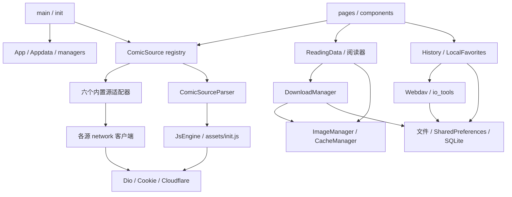

# 架构与启动

[返回知识库](README.md)。本页描述宏观结构与组合根；数据约束见[数据模型](data-model.md)，跨模块调用见[业务流程](business-flows.md)。以下实现结论均为【已实现：静态依据】，应用尚未运行。

## 项目边界

Pica Comic 是单个 Flutter 应用包，版本声明为 `4.2.11+4211`，不是后端服务或多包 monorepo。根 `pubspec.yaml → name / version / dependencies` 定义依赖，`lib/main.dart → main` 是应用入口。上游产品定位、六个内置源和 Fork 来源保留在[根 README](../README.md)。

仓库包含 Android、iOS、Windows、macOS、Linux 和 Web 工程目录；业务层大量使用 `dart:io`、SQLite 和原生插件，不能仅凭 `web/` 或 `.metadata → migration.platforms` 判定 Web 可运行。平台构建证据与环境限制见[开发指南](development.md)。本轮未发现仓库内后端、OpenAPI、独立迁移目录或 ADR；数据库升级逻辑直接写在 Dart manager 中。

## 分层及实际依赖

这是按职责整理的拓扑，并非强制单向分层。`lib/base.dart → Appdata` 引用 WebDAV、下载和历史；`lib/network/download.dart → _onFinish` 刷新 `DownloadPageLogic`；`lib/foundation/local_favorites.dart → updateUI` 直接通知页面控制器。修改基础设施时仍需检查 UI 消费者。

| 范围 | 职责与关键源码锚点 |
| --- | --- |
| `lib/main.dart`、`lib/init.dart` | 组合根：`main`、`init`、旧数据检查、平台初始化 |
| `lib/base.dart`、`lib/foundation/app.dart` | `Appdata` 全局设置及 manager 入口；`App` 平台判断、应用目录、导航与语言 |
| `lib/comic_source/` | `ComicSource` 能力契约、源注册、内置适配；`parser.dart → ComicSourceParser` 将 JS 源转换为 Dart 回调 |
| `lib/pages/`、`lib/components/` | 浏览、搜索、源专用详情、通用详情、设置与响应式 UI；`MainPageState` 组织主导航 |
| `lib/pages/reader/` | `ComicReadingPage`、`ComicReadingPageLogic`、各类 `ReadingData` 处理阅读模式及加载 |
| `lib/network/` | 各源协议客户端、公共 Dio／代理／Cookie、下载、更新与 WebDAV；没有本项目提供的 HTTP 服务端 API |
| `lib/foundation/` | 自定义控制器、SQLite manager、图片／磁盘缓存、日志、JS 桥接 |
| `lib/tools/`、`assets/` | 平台通道、导入导出、翻译和 JS 运行时 API；`assets/init.js` 是自定义源 API 的实现入口 |

## 启动顺序

1. `lib/main.dart → main(args)` 先处理桌面 WebView 标题栏子窗口入口；主应用在 `runZonedGuarded` 中初始化 Flutter binding，然后 `await init()`。
2. `lib/init.dart → init` 先调用 `App.init` 获取 cache/support 目录，设置本轮日志文件，读取 `Appdata`，初始化 `${App.dataPath}/cookies.db`，创建 hosts 配置；`settings[58] == "1"` 时启动本地代理。
3. 注册 Android 链接监听和移动端 Workmanager；检查下载路径与旧数据，再依次等待 `JsEngine.init`、`ComicSource.init`。Cookie 单例必须先于 JS 与图片网络客户端可用。
4. `Future.wait` 初始化下载、NHentai、JM、本地收藏、历史和翻译；最后把 `settings[35]` 的缓存限制应用到 `CacheManager`。
5. `main` 依据 `firstUse[3]` 选择首次使用状态，调用 `setNetworkProxy` 并 `runApp(MyApp)`；代理设置调用没有 `await`，不可把它描述为首屏前已完成。桌面窗口再通过 `windowManager` 配置。
6. `lib/main.dart → _MyAppState.build / onGenerateRoute` 选择 `WelcomePage`、`AuthPage` 或 `MainPage`。生物识别开关为 `settings[13]`，实际验证见 `lib/pages/auth_page.dart → auth`；该本地锁与各漫画源账户登录是两个边界。

`init` 的整个主体捕获异常、写日志后返回；`JsEngine.init` 也会捕获初始化异常。因此“`await init()` 已返回”不保证所有 manager 就绪。此行为属于静态实现，实际失败后的页面表现待运行验证。

## 状态与导航

- `lib/foundation/state_controller.dart → StateController.put/find/update/remove` 维护进程级控制器列表，按类型及可选 `tag` 查找，`find` 取最后匹配项；`StateBuilder` 连接控制器更新与 `setState`。这不是 Riverpod、Bloc 或 GetX。
- `StateBuilder.init` 创建的控制器标记 `autoRemove`；页面手工 `put` 的控制器仍需检查相应 `dispose/remove`。阅读器在 `ComicReadingPage` 构造阶段注册逻辑，并在 dispose 回调中移除。
- `App.navigatorKey` 是外层导航；`lib/pages/main_page.dart → MainPageState.initState` 设置 `App.mainNavigatorKey` 供主页面内部导航。`MainPageState._pages` 对应我、收藏、探索、分类，搜索和设置是导航动作。
- `lib/foundation/app.dart → App.to / globalTo / offAll` 包装 Flutter `Navigator` 和 `AppPageRoute`；响应式阈值见 `App.uiMode`，不能把所有页面当成一套固定手机布局。
- 设置、网络会话、下载队列及 SQLite manager 以全局变量或 factory 单例共享。后台任务另见 `lib/tools/background_service.dart → onStart`，不能假设它与前台共用同一内存状态。

## 继续分析边界

【推测／待核实】窗口／平台通道在各系统的实际兼容性、后台任务凭据装载、控制器销毁后的回调清理、启动异常恢复均未运行。本轮只核对了主入口、状态注册和代表性消费者；UI 组件与各源全部协议分支仍为部分覆盖，详见[索引](README.md)。
