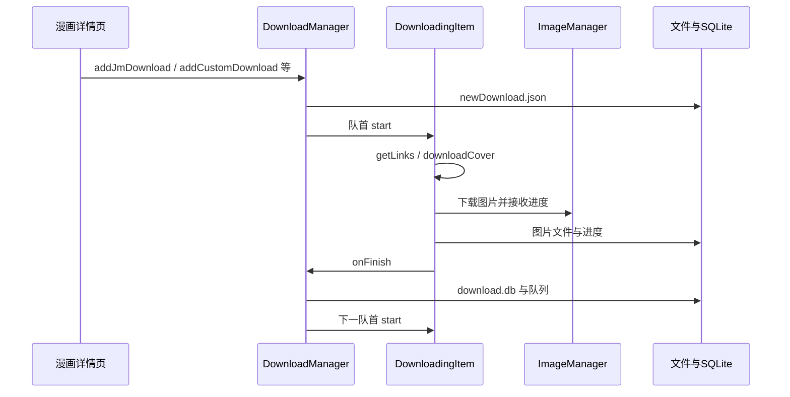

# 代表性业务调用链

[返回知识库](README.md)。本轮按入口、实现、存储／外部边界核对下列流程。调用链说明以【已实现：静态依据】为主；后续中性夹具验证、按用户请求执行的数据恢复及用户验收分别在对应变更中标注，不将它们推广为全源或全部流程通过。启动全链路在[架构页](architecture.md#启动顺序)维护，存储约束在[数据页](data-model.md)维护。

## 通用浏览列表 → 多选本地收藏

【已实现：静态依据】`lib/components/comics_list.dart → ComicsPage.enableMultiSelect` 默认为关闭，仅搜索、分类结果、排行榜及通用探索长列表入口开启，并限定为五个已确认的内置源。网络收藏列表保持默认关闭；分区/混合主页和 Hitomi 不在该接入路径内。需求与验收记录见[本轮变更](changes/2026-11-16-multi-select-favorites.md)。

1. `ComicTile._onLongTap / _showLongTapMenu` 在列表选择上下文中显示“多选”，使用已有 `favoriteItem` 进入列表级 `ComicSelectionController`。
2. `ComicSelectionRegion / ComicSelectionScope` 管理工具栏、返回键和卡片勾选；`ComicTile.build` 在选择期间拦截详情/阅读等卡片内操作。选择键为 `(FavoriteType.key, target)`，全选只使用当前页/已加载的未屏蔽条目。
3. `ComicsPageLogic.refresh / updateMode` 清理选择；`ComicsPage.nextPage / prevPage / selectPage → changePage` 现在跨页保留集合，连续加载也保留选择。分页显示总已选/本页已选，可用“查看已选”图标移除跨页项目；全选和查看使用 32 像素纯图标，全不选图标清空所有页面累计的选择但保留多选状态。当前页计数和全选均按身份去重。
4. 一次选择目标文件夹后，`ComicSelectionController.save → LocalFavoritesManager.addComicsToFolder` 按条目写入并收集新增、已存在、失败；成功项不因其他项失败回滚，失败项保留以重试。收藏表结构不变。
5. 写库完成后更新收藏 UI 并沿用已有 `saveData` 同步行为；封面通过 `_cacheBatchCovers / _cacheComicCover` 后台顺序缓存，不将封面获取失败计为收藏失败。

## 1. JM 搜索 → 详情 → 阅读

1. `lib/pages/search_result_page.dart → SearchResultPage.build` 查找 `sourceKey`，选项数量不匹配时取各选项默认值；通用 `_SearchPageComicList.getComics` 调用 `searchPageData.loadPage`。
2. `lib/comic_source/built_in/jm.dart → jm.searchPageData` 转到 `JmNetwork.searchNew`；后者整理关键词、记录搜索历史并请求 `/search`，返回列表及分页 `subData`。`lib/components/comics_list.dart → ComicsPageLogic.get / loadNextPage` 消费结果、显示错误并控制分页。
3. JM 的 `_JmComicTile.onTap_` 打开 `ComicPage(sourceKey: 'jm', ...)`；`lib/pages/comic_page.dart → ComicPage.build` 发现 `comicPageBuilder` 后使用 `JmComicPage`，不是通用 `_ComicPageImpl`。
4. `lib/pages/jm/jm_comic_page.dart → JmComicPage.loadData` 请求 `JmNetwork.getComicInfo` 的 `/album`，解析章节、作者和收藏等信息。`read` 先 `History.createIfNull`，再构造 `ComicReadingPage.jmComic`；指定章节入口 `eps` 把 0 基索引转为 1 基章节号。
5. `lib/pages/reader/reading_data.dart → JmReadingData.loadEpNetwork` 通过章节 ID 调 `JmNetwork.getChapter` 的 `/chapter`；已下载章节会在 `ReadingData.loadEp` 更早走本地分支。网络图片进入 `ImageManager.getJmImage`，下载、重组后缓存。
6. `ComicReadingPageLogic.index` 变化回调 `_updateHistory`，写章节、页码和最大页数；阅读器退出时保存历史、执行本地收藏的阅读后排序、恢复屏幕设置。源码分别位于 `reading_logic.dart → index`、`comic_reading_page.dart → _updateHistory / build`。

失败边界：普通网络／解析错误通常转换为 `Res.error`；但 `JmNetwork.getComicInfo` 在部分“Empty data”路径显式抛异常，不能说所有失败都由 `Res` 表达。章节 `Res.error` 被 `ComicReadingPage.loadInfo` 写入 `logic.errorMessage`；图片失败由图片 provider／控件处理。实际重试、失效会话及图片错误 UI 尚未验证。

### 搜索页折叠分组

【已实现：静态依据】`lib/pages/pre_search_page.dart → PreSearchPage.buildSearchSection` 用 Flutter 的 `ExpansionTile` 显示「历史搜索」和「收藏」标题。首次打开时历史搜索展开、收藏收起。点击面板后分别记录开合状态，下次进入或重启应用后恢复。本机状态由 `lib/base.dart → Appdata.searchHistoryExpanded / searchFavoritesExpanded` 读写 `implicitData[4]` 和 `implicitData[5]`，旧数据缺少这两个位置时沿用默认值。窄屏在搜索选项下显示，宽屏沿用左右栏位置。标题中的清空按钮继续使用原有二次确认，组内条目继续支持点击搜索和单项移除。展开内容在外层滚动视图内按需构建，手机上的历史搜索保留「查看更多」。

【已验证：执行证据】6217 测试包已构建并覆盖安装到真机。安装前备份应用数据，并在安装后核对数据库和设置文件。按用户要求未运行测试，折叠和清空交互待用户验收。

【已实现：静态依据】两个分组的展开和收起状态都使用无边框的形状。标题局部关闭水波纹和按下高亮，箭头继续指示开合状态，清空按钮沿用原主题和确认行为。

【已验证：执行证据】6218 已覆盖安装到真机。安装前已备份应用数据。安装时应用启动并刷新了运行配置，安装后的收藏、历史和阅读统计与备份核对一致。按用户要求未运行测试。

### 搜索历史来源和收藏

【已实现：静态依据】`lib/base.dart → Appdata.recordSearch` 对去掉首尾空白的非空搜索词保留一条历史，来源键去重并把最近使用的来源移到最前。内置来源在现有网络搜索入口记录，数字分页只在请求第一页时写入；扩展来源由 `lib/pages/search_result_page.dart → _SearchPageComicList.getComics` 的首个源页记录。`search` 仍保存关键词列表，`searchSources` 保存各词的来源列表。旧历史没有可恢复的来源，搜过该词后才显示新记录的来源。

【已实现：静态依据】`lib/pages/pre_search_page.dart → buildHistoryRow / buildHistoryItem` 将来源标识从左到右按最近使用顺序放在行右侧，沿用原 `Flyout` 的行下缘定位。长按菜单横排「收藏」「删除」，单项删除一次生效，清空全部仍要求确认。收藏标题的加号提供「手动输入」和「从历史选择」。`editSearchFavorite` 允许勾选多个可用漫画源，历史入口预勾选该词记录过的可用源，手动入口从空选择开始；相同来源和搜索词只保存一次。搜索收藏仍以源和关键词保存到 `favoriteTags`，兼容旧来源名称。

五个内置源标识随包发布，运行时由 `buildSourceIcon` 读取本地 PNG。EHentai、JMComic、Hitomi、NHentai 使用站点标识，Picacg 使用用户提供的图标；其余来源显示通用图标。

【已实现：静态依据】`buildHistoryRow` 将来源图标靠右，最多显示其最近三个来源，剩余数量显示为 `+N`；进入收藏弹窗时仍预选全部记录过的可用源。`buildFavoriteList` 仅显示与当前搜索目标匹配的收藏，切换来源即刷新，清空按钮的确认内容明确标注作用于所有源。搜索栏点外部或打开历史、收藏长按菜单时释放输入焦点，防止关闭菜单后系统恢复键盘。选择搜索建议沿用当前焦点，手动添加收藏在用户点进输入框后才打开键盘。

【已验证：执行证据】ARM64 测试包包含五张来源图标，并与真机既有测试包的包名、签名匹配。备份旧 APK 和应用数据后，已在 Android 14 覆盖安装并冷启动至主界面。本地收藏和阅读历史数据库文件与备份一致，阅读统计表的记录一致。启动后观察到既有的 JM 分流、图片地址和同步版本设置更新，并新增此前已实现的收藏角标设置默认值。

【已验证：执行证据】后续界面调整使用模拟来源和搜索词完成 Flutter 控件回归，覆盖单图标右对齐、三图标与余量、当前源筛选、长按后打开收藏时无新的键盘显示请求，以及手动输入仅点击后唤起键盘。核对 APK 内 Picacg 图标与用户提供图像转换后的资源一致，备份旧包及数据后已覆盖安装到 Android 14，确认主界面在前台。

### 漫画列表与详情横滑

【已实现：静态依据】搜索页的收藏加号在 `lib/pages/pre_search_page.dart → pickSearchFavorite` 打开与漫画长按菜单同字号的选项列表，手动输入和从历史选择各有图标。通用漫画卡片在多选中短按仍切换勾选，长按打开普通操作菜单并保留选择，菜单省略已经生效的「多选」入口。本地收藏列表长按也打开自己的操作菜单。对应入口为 `lib/components/comic_tile.dart → ComicTile._onLongTap` 和 `lib/pages/favorites/main_favorites_page.dart → ComicsPageView`。

【已实现：静态依据】`lib/pages/comic_page.dart → ComicDetailBrowser` 记录进入详情时的条目顺序。左滑下一本，右滑上一本，到首尾时停留；返回键回到原列表。通用连续列表和 Hitomi 搜索使用已加载条目，通用分页和本地收藏使用进入时当前页或视图，阅读历史及本地收藏搜索使用当前结果。未加载项、已屏蔽的通用列表项和不可用的收藏项不进入切换序列。没有可用相邻项的单独详情入口继续打开单本详情。

【已验证：执行证据】ARM64 调试 APK 已构建，核对包名和签名并备份手机上的旧包及数据后，覆盖安装并确认应用主界面在前台。按用户交付方式直接更新，本轮未运行交互用例。

【已实现：静态依据】`ComicDetailBrowser` 使用 Flutter `PageView`。拖动时当前页与相邻页随手指平移，松手后由分页物理效果吸附到相邻页或回到原页。首次拖出相邻页时，可先显示列表标题和封面，停稳后请求该漫画的完整详情。相邻页有独立状态，阅读器退出时由 `BaseComicPage.notifyReadingHistory` 按源和阅读目标更新对应详情。EH 内容警告只在对应详情处于当前页时弹出。

【已验证：执行证据】使用模拟详情完成 Flutter 控件回归，确认左右拖动时两页位置同时移动，短拖回到原页，翻页停稳后相邻页接收操作，列表边界停留且返回回到原列表。ARM64 更新包通过包名与签名检查，备份旧 APK 和应用数据后覆盖安装至真机并确认主界面启动。

【已实现：静态依据】「设置 → 浏览 → 详情页左右滑动切换漫画」使用 `lib/base.dart → Appdata.settings[97]`，默认开启，旧设置缺少这一项时沿用默认值。关闭后 `ComicDetailBrowser.open` 直接打开点中的单本详情，下次从列表进入时生效。

【已验证：执行证据】模拟详情回归通过，开关开启时可跟手翻页，关闭后从同一列表打开的是点中的单本详情。后续按用户要求直接覆盖安装到 Android 真机，安装前备份旧包和应用数据。应用主界面已启动，本轮安装未重跑测试。

【已验证：用户验收】用户于 2026-11-21 确认真机测试版 6224 验收通过。该版本包含上述搜索页与搜索收藏调整、多选长按菜单、详情跟手滑动及其浏览设置开关。提交发布前按用户要求未重跑测试。

### 远程列表变化与分页一致性

【已实现：静态依据】通用列表没有为整次浏览固定远端数据快照。`lib/components/comics_list.dart → ComicsPageLogic.loadNextPage` 请求下一逻辑页后直接 `comics.addAll(res.data)`，未做列表身份去重，也不回头核对已加载条目。分页模式在 `dividedComics` 缓存已访问的应用页，合并 2／3 个源页时还在 `_sourcePages` 缓存每个成功的源页。分组失败后重试复用本组缓存，显式刷新清除缓存。详见[源页合并](changes/2026-11-19-source-page-grouping.md)。

| 模式 | 当前客户端行为 | 远端变化时的条件性影响 |
| --- | --- | --- |
| 连续 | 保留旧条目，追加新响应 | 页码边界变化可造成重复/漏项；远端删除的旧条目不会自动从当前列表移除 |
| 分页 | 已访问页复用缓存，未访问页向源适配器请求 | 缓存页和后加载页可能来自不同时点；翻回旧页不保证重新请求，边界变化同样可能重复/漏项 |

【推演／待核实】假设源按当前排序和固定每页 3 条进行偏移分页：首次为 `A B C | D E F`。看过第一页后若顶部插入 X，新第二页变为 `C D E`，C 会重复，X 不会自动插回已看过的第一页；若删除已看过的 B，第二页变为 `E F G`，D 可能被跳过。按热度等排序重新排列也会产生类似边界变化。该例是分页算法推演，未向真实站点执行增删测试，不表示每个源都有相同服务端实现。

【已实现：静态依据】搜索适配器中，JM 的 `JmNetwork.searchNew`、哔咔 `PicacgNetwork.search`、HT `HtmangaNetwork.getComicList`、NHentai `NhentaiNetwork.search` 都发送页码参数或页码 URL。EH 经 `lib/network/eh_network/eh_gallery_page_loader.dart → EhGalleryPageLoader` 缓存结果，并跟随 `EhNetwork.getGalleries` 从网页 `dnext` 提取的下一页链接。应用页号先换算为源页组，再由 EH 适配器按链接解析个别源页。EH 的游标在服务端动态变化时的表现仍待在线核对。

多选键仍是 `(FavoriteType.key, target)`，收藏写入也按 `(target,type)` 查重，所以列表出现重复卡片不代表同一收藏夹会重复写入。已加载元数据不会因远端删除而主动失效，仍可能保存为本地收藏，之后详情/阅读可能不可用。分页切页与连续追加均保留选择；显式刷新/切换范围等边界仍清空。

其他静态边界：`loadNextPage` 在返回 `Res.error` 后仍执行 `current++`，失败页可能被跳过；连续与分页的后续成功响应现在都会更新 `maxPage`，但已缓存页及已判定结束的列表不会主动探测远端新增页。连续追加错误递增页号这一问题尚未修改；跨页选择实施已调整分页缓存响应归属、当前页重试和总页数更新，详见[跨页变更](changes/2026-11-16-cross-page-selection.md)。

### 分页跨页多选

用户已明确要求实施，现已替代首版翻页清空规则。需求、源码依据和验证范围见[跨页变更](changes/2026-11-16-cross-page-selection.md)。

【已实现：静态依据】`ComicSelectionController` 按 `(FavoriteType.key,target)` 保存选中时的 FavoriteItem 副本，重复条目不覆盖原资料；`ComicsPageLogic.changePage` 保留选择，`get` 按请求时页号缓存响应，`retry` 重试当前页并保留集合。分页空页和错误页也提供翻页入口，远端总页数缩小时可返回先前页。

同一列表会话内，上一页/下一页/跳页保留；全选仅追加当前页；工具栏显示总已选和本页已选，“查看已选”可移除任意已选项目。普通收藏和长按快速收藏提交整个集合；刷新、换源、改关键词/筛选/排序、切换显示模式、退出多选或关闭列表会话清空，不跨重启持久化。

远端新增不自动选中，重排或跨页重复按来源+ID识别；新页没有出现某项不等于远端已删除，因此不自动取消该项。仍可用选中时元数据保存本地收藏，后续详情/阅读可能失效，不默认逐条远程校验。跨页选择保持集合稳定，不保证页码源遍历无漏项，也不改变 EH 服务端下一页规则。

## 2. 安装自定义源 → 通用详情与图片

1. `lib/pages/settings/comic_source_settings.dart → chooseFile / handleAddSource` 从本地 `.js` 或 URL 获取文本，统一进入 `addSource`。
2. `lib/comic_source/parser.dart → createAndParse` 把内容写入应用 `comic_source/`；解析失败删除本次创建的文件并重新抛错。`parse` 要求首个非空行以 `class ` 开头且包含 `extends ComicSource`，执行脚本后读取元信息，检查最低版本、重复 key 和 key 字符集。
3. `ComicSourceParser.parse` 将 JS 实例登记到 `ComicSource.sources.<key>`，把搜索、详情、章节、收藏等转换成 Dart 回调，读取源 `.data`，延迟调用源 `init()`。安装成功后设置页 `addSource` 将 Dart 实例加入 registry、添加页面配置、保存设置并刷新应用。
4. 通用搜索经过 `_loadSearchData` 调 JS `search.load(keyword, options, page)`，结果 `{comics, maxPage}` 转成 `CustomComic` 列表；通用详情 `ComicPage → _ComicPageImpl.loadData` 调 `comic.loadInfo(id)` 转成 `ComicInfoData`。
5. `_ComicPageImpl.read / eps` 创建历史并构造 `CustomReadingData`；其 `loadEpNetwork` 调 `comic.loadEp(id, ep)`，解析 `{images}`。`ImageManager.getCustomImage` 应用 `comic.onImageLoad` 返回的 URL／method／headers／data，以及可选 `onResponse` 字节转换。

失败边界：元信息非法或版本过低导致安装失败；单个已安装源启动解析失败会由 `ComicSource.init` 记录后继续其他源。回调异常通常转换成 `Res.error`；收藏和发评论的部分路径识别含 `Login expired` 的错误并尝试重新登录一次，不能推广到全部请求。已保存的账户状态和实际 Cookie 有效性也不同，见[漫画源模块](modules/comic-sources.md)。

## 3. 下载 → 重启恢复 → 本地阅读

入口依据：`lib/pages/jm/jm_comic_page.dart → download`、`lib/pages/comic_page.dart → _ComicPageImpl.download`，最终进入 `lib/network/download.dart → AddDownloadExt`。详情页先检查重复／已下载并选择章节；不能假设 manager 对所有直接调用也强制完成同等去重。

核心依据：`DownloadManager._saveInfo / _onFinish / start`、`lib/network/download_model.dart → DownloadingItem.start / _scheduleTasks / toBaseMap`。队列按漫画串行，任务内按 `settings[79]` 并发图片，默认 6；任务出错采用延迟重试，超过 4 次重试后调用 manager `_onError` 暂停并保留错误状态。

恢复依据：启动 `DownloadManager.init → _getInfo` 从 JSON 重建任务；`lib/pages/main_page.dart → _checkDownload` 询问是否继续，不是自动无条件恢复。队列 JSON 损坏时记录日志、删除该 JSON 并重建，不能承诺保留所有未完成任务。

本地阅读依据：`lib/pages/download_page.dart → ReadComic.read` 根据下载类型重建源对应阅读数据与历史；`ReadingData.loadEp / createImageProvider` 根据已下载章节选择 `FileImageProvider`，否则走网络。下载文件缺失、源被禁用以及自定义源丢失时的兼容表现仍待验证，详见[阅读与下载模块](modules/reader-download.md)。

【已实现：静态依据】多选工具栏的“本地收藏”短按选择收藏夹，长按由 `ComicSelectionRegion._quickSave` 直接使用设置中的快速收藏夹 `settings[51]`；未配置/目标失效时仅提示并保留选择。两种操作复用批量写入与结果反馈，见[多选收藏变更](changes/2026-11-16-multi-select-favorites.md#多选长按快速收藏2026-11-16)。

## 4. 本地收藏 → 备份与同步导入

1. 以 JM 为代表，`JmComicPage.openFavoritePanel` 区分平台收藏和本地收藏：平台操作调用 `JmNetwork.favorite`，本地操作进入 `LocalFavoritesManager.addComic`。平台收藏可用性受源登录状态影响，本地收藏有独立数据表。
2. `lib/foundation/local_favorites.dart → addComic` 查重、插入目标收藏夹表，通知 UI、请求 WebDAV 上传，并尝试把封面复制到 `favoritesCover/`；封面复制失败会被忽略，不等于插入回滚。
3. `lib/network/webdav.dart → uploadData` 调用 `lib/tools/io_tools.dart → exportDataToFile(false, ...)` 生成不含下载目录的包，按版本名上传。配置与包内容仅在[接口页](api-integrations.md#webdav-与数据包)维护。
4. `Webdav.downloadData → importData / importDataFromFile` 在独立目录解包校验；旧／相同 WebDAV 版本整包跳过，手工选择文件绕过版本限制。`LocalFavoritesManager.readData` 与 `HistoryManager.tryUpdateDb` 调用后台事务合并缺少的记录，每库一次提交后刷新缓存；历史启动也恢复暂存库。源文件和 Cookie 的替换语义与收藏合并不同，不能笼统说“全部合并”或“全部覆盖”。

失败边界：`addComic` 是 `async void`，调用方显示成功不代表封面和同步已完成；WebDAV 上传返回值也未被所有写调用等待。大库与暂存恢复已有[独立真机回归及本机恢复记录](changes/2026-11-16-data-import-recovery.md)，但远端失败后的 UI、并发本地变更和跨多个数据库/文件的整包原子性仍未验证。

## 未覆盖的流程

【推测／待核实】其他五源登录、搜索边界、网络收藏夹与本地文件夹持续关联同步、批量导出／PDF、全部阅读手势与双页模式、后台签到、所有深链接路径没有完成端到端分析或执行。继续入口与优先级在[索引](README.md#快照与继续入口)。
