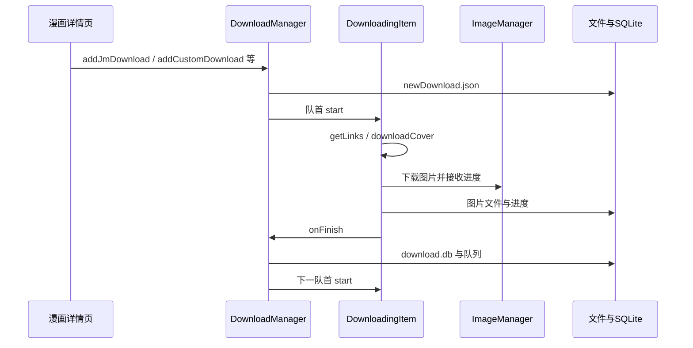

# 代表性业务调用链

[返回知识库](README.md)。本轮按入口、实现、存储／外部边界核对下列流程。全部为【已实现：静态依据】，没有使用真实账户运行。启动全链路在[架构页](architecture.md#启动顺序)维护，存储约束在[数据页](data-model.md)维护。

## 1. JM 搜索 → 详情 → 阅读

1. `lib/pages/search_result_page.dart → SearchResultPage.build` 查找 `sourceKey`，选项数量不匹配时取各选项默认值；通用 `_SearchPageComicList.getComics` 调用 `searchPageData.loadPage`。
2. `lib/comic_source/built_in/jm.dart → jm.searchPageData` 转到 `JmNetwork.searchNew`；后者整理关键词、记录搜索历史并请求 `/search`，返回列表及分页 `subData`。`lib/components/comics_list.dart → ComicsPageLogic.get / loadNextPage` 消费结果、显示错误并控制分页。
3. JM 的 `_JmComicTile.onTap_` 打开 `ComicPage(sourceKey: 'jm', ...)`；`lib/pages/comic_page.dart → ComicPage.build` 发现 `comicPageBuilder` 后使用 `JmComicPage`，不是通用 `_ComicPageImpl`。
4. `lib/pages/jm/jm_comic_page.dart → JmComicPage.loadData` 请求 `JmNetwork.getComicInfo` 的 `/album`，解析章节、作者和收藏等信息。`read` 先 `History.createIfNull`，再构造 `ComicReadingPage.jmComic`；指定章节入口 `eps` 把 0 基索引转为 1 基章节号。
5. `lib/pages/reader/reading_data.dart → JmReadingData.loadEpNetwork` 通过章节 ID 调 `JmNetwork.getChapter` 的 `/chapter`；已下载章节会在 `ReadingData.loadEp` 更早走本地分支。网络图片进入 `ImageManager.getJmImage`，下载、重组后缓存。
6. `ComicReadingPageLogic.index` 变化回调 `_updateHistory`，写章节、页码和最大页数；阅读器退出时保存历史、执行本地收藏的阅读后排序、恢复屏幕设置。源码分别位于 `reading_logic.dart → index`、`comic_reading_page.dart → _updateHistory / build`。

失败边界：普通网络／解析错误通常转换为 `Res.error`；但 `JmNetwork.getComicInfo` 在部分“Empty data”路径显式抛异常，不能说所有失败都由 `Res` 表达。章节 `Res.error` 被 `ComicReadingPage.loadInfo` 写入 `logic.errorMessage`；图片失败由图片 provider／控件处理。实际重试、失效会话及图片错误 UI 尚未验证。

## 2. 安装自定义源 → 通用详情与图片

1. `lib/pages/settings/comic_source_settings.dart → chooseFile / handleAddSource` 从本地 `.js` 或 URL 获取文本，统一进入 `addSource`。
2. `lib/comic_source/parser.dart → createAndParse` 把内容写入应用 `comic_source/`；解析失败删除本次创建的文件并重新抛错。`parse` 要求首个非空行以 `class ` 开头且包含 `extends ComicSource`，执行脚本后读取元信息，检查最低版本、重复 key 和 key 字符集。
3. `ComicSourceParser.parse` 将 JS 实例登记到 `ComicSource.sources.<key>`，把搜索、详情、章节、收藏等转换成 Dart 回调，读取源 `.data`，延迟调用源 `init()`。安装成功后设置页 `addSource` 将 Dart 实例加入 registry、添加页面配置、保存设置并刷新应用。
4. 通用搜索经过 `_loadSearchData` 调 JS `search.load(keyword, options, page)`，结果 `{comics, maxPage}` 转成 `CustomComic` 列表；通用详情 `ComicPage → _ComicPageImpl.loadData` 调 `comic.loadInfo(id)` 转成 `ComicInfoData`。
5. `_ComicPageImpl.read / eps` 创建历史并构造 `CustomReadingData`；其 `loadEpNetwork` 调 `comic.loadEp(id, ep)`，解析 `{images}`。`ImageManager.getCustomImage` 应用 `comic.onImageLoad` 返回的 URL／method／headers／data，以及可选 `onResponse` 字节转换。

失败边界：元信息非法或版本过低导致安装失败；单个已安装源启动解析失败会由 `ComicSource.init` 记录后继续其他源。回调异常通常转换成 `Res.error`；收藏和发评论的部分路径识别含 `Login expired` 的错误并尝试重新登录一次，不能推广到全部请求。已保存的账户状态和实际 Cookie 有效性也不同，见[漫画源模块](modules/comic-sources.md)。

## 3. 下载 → 重启恢复 → 本地阅读

入口依据：`lib/pages/jm/jm_comic_page.dart → download`、`lib/pages/comic_page.dart → _ComicPageImpl.download`，最终进入 `lib/network/download.dart → AddDownloadExt`。详情页先检查重复／已下载并选择章节；不能假设 manager 对所有直接调用也强制完成同等去重。

核心依据：`DownloadManager._saveInfo / _onFinish / start`、`lib/network/download_model.dart → DownloadingItem.start / _scheduleTasks / toBaseMap`。队列按漫画串行，任务内按 `settings[79]` 并发图片，默认 6；任务出错采用延迟重试，超过 4 次重试后调用 manager `_onError` 暂停并保留错误状态。

恢复依据：启动 `DownloadManager.init → _getInfo` 从 JSON 重建任务；`lib/pages/main_page.dart → _checkDownload` 询问是否继续，不是自动无条件恢复。队列 JSON 损坏时记录日志、删除该 JSON 并重建，不能承诺保留所有未完成任务。

本地阅读依据：`lib/pages/download_page.dart → ReadComic.read` 根据下载类型重建源对应阅读数据与历史；`ReadingData.loadEp / createImageProvider` 根据已下载章节选择 `FileImageProvider`，否则走网络。下载文件缺失、源被禁用以及自定义源丢失时的兼容表现仍待验证，详见[阅读与下载模块](modules/reader-download.md)。

## 4. 本地收藏 → 备份与同步导入

1. 以 JM 为代表，`JmComicPage.openFavoritePanel` 区分平台收藏和本地收藏：平台操作调用 `JmNetwork.favorite`，本地操作进入 `LocalFavoritesManager.addComic`。平台收藏可用性受源登录状态影响，本地收藏有独立数据表。
2. `lib/foundation/local_favorites.dart → addComic` 查重、插入目标收藏夹表，通知 UI、请求 WebDAV 上传，并尝试把封面复制到 `favoritesCover/`；封面复制失败会被忽略，不等于插入回滚。
3. `lib/network/webdav.dart → uploadData` 调用 `lib/tools/io_tools.dart → exportDataToFile(false, ...)` 生成不含下载目录的包，按版本名上传。配置与包内容仅在[接口页](api-integrations.md#webdav-与数据包)维护。
4. `Webdav.downloadData → importData` 写入临时数据；`LocalFavoritesManager.readData` 为缺少的收藏夹／条目补入记录，`HistoryManager.tryUpdateDb` 导入缺少的历史／图片收藏。源文件和 Cookie 的替换语义与收藏合并不同，不能笼统说“全部合并”或“全部覆盖”。

失败边界：`addComic` 是 `async void`，调用方显示成功不代表封面和同步已完成；WebDAV 上传返回值也未被所有写调用等待。远端失败后的 UI、并发本地变更与包导入恢复需要专门运行验证。

## 未覆盖的流程

【推测／待核实】其他五源登录、搜索边界、网络收藏夹与本地文件夹持续关联同步、批量导出／PDF、全部阅读手势与双页模式、后台签到、所有深链接路径没有完成端到端分析或执行。继续入口与优先级在[索引](README.md#快照与继续入口)。
